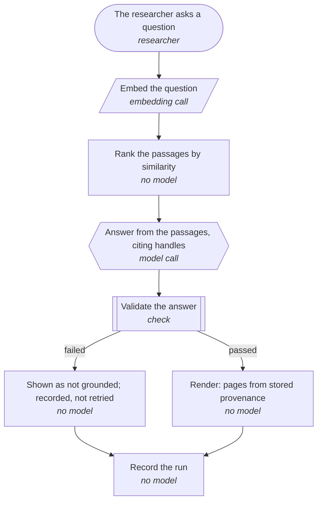
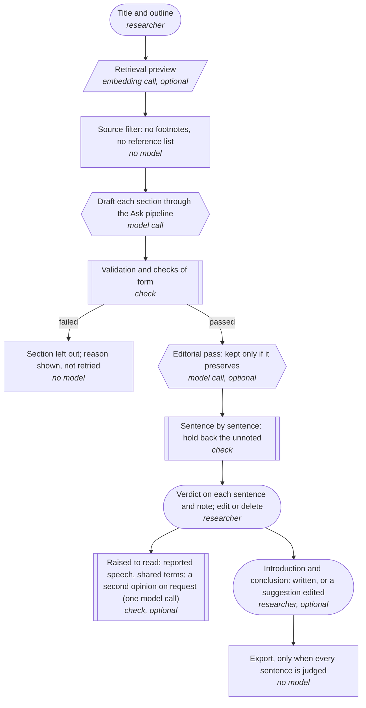
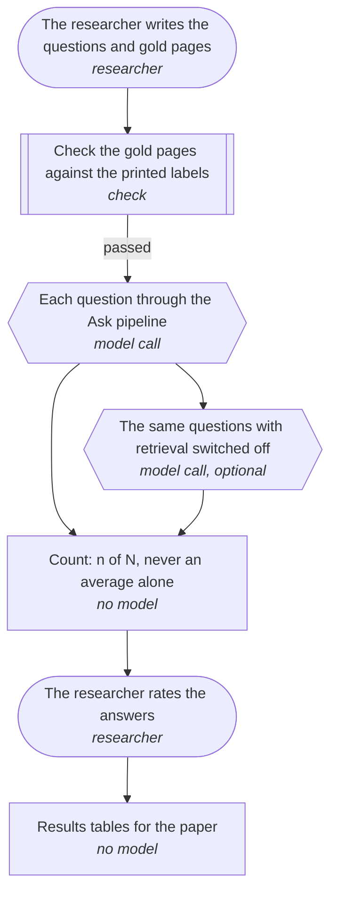
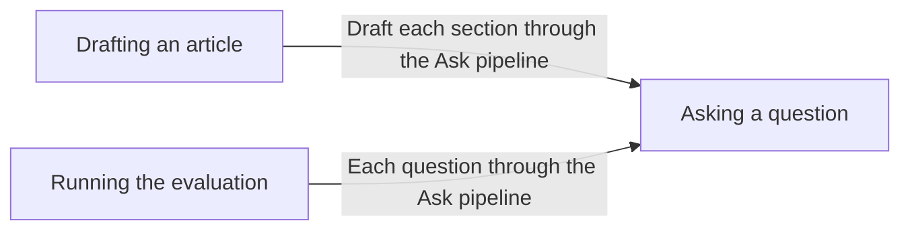

# The three workflows

Generated by `python scripts/workflow_diagrams.py` from `workflows.py`. Do not edit by hand:
a test fails if this file and that module disagree, or if a function a step names no longer exists.

Each workflow is a fixed sequence. None has a loop or a retry, and no step lets a model decide
what happens next. A step's kind is written in it:

| Kind | Shape | Meaning |
|---|---|---|
| researcher | rounded | a person decides or writes |
| model call | hexagon | the generation model is called, and credit is spent |
| embedding call | slanted | the embedding provider is called |
| check | double-edged box | plain code that passes, blocks or raises; never a model's verdict |
| no model | rectangle | plain code |

## Asking a question

| Step | Kind | Carried out by |
|---|---|---|
| The researcher asks a question | researcher | the researcher |
| Embed the question | embedding call | `embeddings.embed_texts` |
| Rank the passages by similarity | no model | `ask.retrieve` |
| Answer from the passages, citing handles | model call | `ask.call_model` |
| Validate the answer | check | `ask.validate` |
| Shown as not grounded; recorded, not retried | no model | the researcher |
| Render: pages from stored provenance | no model | `ask.render`, `ask.page_phrase` |
| Record the run | no model | `runs.append` |

## Drafting an article

| Step | Kind | Carried out by |
|---|---|---|
| Title and outline | researcher | `article.topics.outline`, `article.pipeline.new_draft` |
| Retrieval preview | embedding call (optional) | `article.pipeline.preview` |
| Source filter: no footnotes, no reference list | no model | `article.sources.open_sources` |
| Draft each section through the Ask pipeline | model call | `article.pipeline.draft_section`, `ask.run_query` |
| Validation and checks of form | check | `ask.validate`, `article.checks.prose_failures` |
| Section left out; reason shown, not retried | no model | `article.assemble.block_reason` |
| Editorial pass: kept only if it preserves | model call (optional) | `article.pipeline.edit_section`, `article.checks.editorial_failures` |
| Sentence by sentence: hold back the unnoted | check | `article.assemble.assemble` |
| Verdict on each sentence and note; edit or delete | researcher | `article.pipeline.set_pair_verdict`, `article.pipeline.edit_sentence`, `article.pipeline.delete_sentence`, `article.pipeline.keep_as_own_words` |
| Raised to read: reported speech, shared terms; a second opinion on request (one model call) | check (optional) | `article.checks.reported_speech_flags`, `article.terms.shared_terms`, `article.pipeline.second_opinion` |
| Introduction and conclusion: written, or a suggestion edited | researcher (optional) | `article.pipeline.suggest_frame`, `article.pipeline.set_frame` |
| Export, only when every sentence is judged | no model | `article.pipeline.export_blockers`, `article.pipeline.export` |

## Running the evaluation

| Step | Kind | Carried out by |
|---|---|---|
| The researcher writes the questions and gold pages | researcher | the researcher |
| Check the gold pages against the printed labels | check | `scripts.check_gold.main` |
| Each question through the Ask pipeline | model call | `evaluate.evaluate_question`, `ask.run_query` |
| The same questions with retrieval switched off | model call (optional) | `evaluate.run` |
| Count: n of N, never an average alone | no model | `evaluation.metrics.summarise` |
| The researcher rates the answers | researcher | `evaluate.write_rating_sheet` |
| Results tables for the paper | no model | `scripts.results_tables.main` |

## How they connect

There is one pipeline. Drafting and evaluating both send their questions through it; neither
has a retrieval or citation path of its own.

